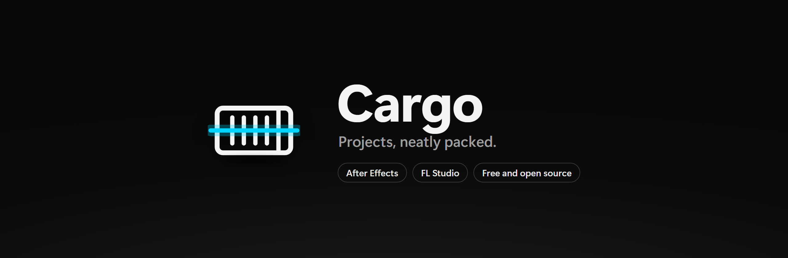

<p align="center">
  
</p>

<p align="center">
  <a href="https://github.com/slashneck/Cargo/releases/latest"></a>
  <a href="https://github.com/slashneck/Cargo/releases"></a>
  
  <a href="LICENSE"></a>
</p>

<p align="center">
  <a href="https://github.com/slashneck/Cargo/releases/latest"><b>Download for Windows</b></a>
  &nbsp;&nbsp;|&nbsp;&nbsp;
  <a href="#features">Features</a>
  &nbsp;&nbsp;|&nbsp;&nbsp;
  <a href="#fl-studio">FL Studio</a>
  &nbsp;&nbsp;|&nbsp;&nbsp;
  <a href="#packaging">Packaging</a>
  &nbsp;&nbsp;|&nbsp;&nbsp;
  <a href="#building">Build it yourself</a>
</p>

<br>

Cargo opens After Effects and FL Studio projects without the programs and shows you every file they use. Drop an
`.aep` or `.flp` on it and you see what's used, what's dead weight and what's missing. Then package the project for a
client, archive it to another drive, or clean up what you don't need anymore.

## Features

| Program | Project files | What Cargo shows |
| --- | --- | --- |
| After Effects | `.aep`, `.aepx` | footage, audio, sequences, stills, graphics and data files; comps; effects |
| FL Studio | `.flp` | samples, recordings, renders and stock samples; patterns and the playlist; plugins |

**Every file at a glance.** Size, resolution, duration, frame rate and where each file sits in your project. Thumbnails and
a preview for images, video and audio. Search, filter by type or status and sort however you like, even with thousands
of items.

**Used, unused, missing.** Green is used, yellow is used but missing, red is unused, and purple is on disk but not in the
project at all. In After Effects an item counts as used when a layer in any composition uses it, or an expression reads
it (`footage("scores.json")`). In FL Studio a sample counts when it's on the playlist, or its channel plays notes in a
pattern that is. For every file you see which comps or patterns use it, and for every comp or pattern which files it
pulls in.

**Find missing files.** Cargo looks on your other drives, around the project and in folders you add, lets you confirm
each match or pick the file yourself, and saves a relinked copy of the project.

**Clean up.** Send unused files and leftovers to the Recycle Bin, tick any files you like, or clear out all of a
project's media in one go. Favorites, files tagged `keep` and files another project still needs are never picked for
you. **Organize** sorts the files into tidy folders and saves a project that points to them. **Archive** copies a
finished project with all its files to another drive, checks the copy, and can then remove the originals.

**Insights.** How big the project really is, how much you'd save by deleting what's unused, how long it takes to send,
the largest files, and which comps or patterns are the heaviest. The effects and plugins tab lists every plugin the
project needs, with third-party ones flagged.

**More.** Duplicate finder, batch scanning of whole folders (auto-saves are skipped), manifests as PDF, text, CSV or
JSON, tags and favorites, and a history of everything you packaged.

## FL Studio

Recording vocals means a lot of takes, and FL Studio keeps every one of them in `Audio\Recorded` even after you delete
the channel. Renders and consolidated clips pile up in `Audio\Rendered` the same way. Open an `.flp` in Cargo and it
shows:

- **What the song uses.** A sample counts as used when it's on the playlist, or when its channel plays notes in a pattern
  that is. Takes still sitting in the channel rack without being used show up as unused.
- **What isn't in the project at all.** Recordings, renders and samples in your recording and render folders and the
  project's folder that the project doesn't reference. Before calling a file a leftover, Cargo reads your other FL
  Studio projects and keeps every file one of them still uses. "Where Cargo looked" shows the folders it searched, and you
  can add the folders where you keep your projects.
- **Recordings, renders, samples and stock samples** sorted apart, with the length of every WAV, the channel each sample
  sits on, and which VST plugins the project needs.

Packages put the samples next to the `.flp`, which is where FL Studio looks for them, and leave FL Studio's stock samples
out unless you want them.

## Packaging

Package Project writes a zip or a folder named `Project_Package_YYYY-MM-DD` with the project, its files sorted by type
or by your project folders, and a `MANIFEST.txt`. After Effects packages also get a `Relink Footage.jsx` script. Unused
files stay out unless you want them, and a single composition or pattern can be packaged on its own.

Packages are **private** by default. File paths inside a project contain your user name and folder structure, an `.aep`
keeps a save history with times, and an `.flp` keeps your FL Studio licensee name and the project's dates. A private
package points every path to a neutral folder named after the package, removes that information, and keeps paths, dates
and version info out of the manifest. FL Studio finds the samples next to the project wherever you open it. For After
Effects, extract the package to `C:\` and everything links up, or open it anywhere and run `Relink Footage.jsx`
(File › Scripts › Run Script File).

Your original project is never changed. Packages, archives and relinks always write new files.

## Install

Download `CargoSetup` from the [latest release](https://github.com/slashneck/Cargo/releases/latest) and run it. It
installs for your Windows account only, so no admin rights are needed, and it keeps itself up to date.

The setup isn't code signed yet, so Windows SmartScreen may say it "protected your PC". Click **More info** and then
**Run anyway**. Every release lists the SHA-256 checksum of its files. If you'd rather not install anything, the
`win-x64.zip` is a portable version: unzip it anywhere and run `Cargo.exe`.

You need Windows 10 or 11, 64 bit.

## Where your files are

| What | Where |
| --- | --- |
| Settings, tags, recent projects and history | `%AppData%\Cargo` |
| The program | `%LocalAppData%\Programs\Cargo` |

Deleted files go to the Recycle Bin. Uninstalling removes the program and keeps your settings, unless you tick the box
to remove them too.

## Updates

When Cargo starts, it asks GitHub whether a newer version exists. If there is one, you can install it from inside Cargo:
the new setup is downloaded, checked against its SHA-256 checksum and run. You can switch the check off under Help.

## Good to know

- Fonts aren't packaged, and neither are plugins. The manifest lists both so whoever opens the project knows what to install.
- Delete Unused removes files, not project items. In After Effects, File › Dependencies › Remove Unused Footage tidies up
  the project itself; in FL Studio, delete the channels you no longer need.
- Leftovers are only as safe as the projects Cargo can see. Add the folders where you keep your projects under "Where
  Cargo looked", and everything still goes to the Recycle Bin first.
- Projects saved on a Mac have `/Volumes/...` paths and show as missing on Windows until you run Find Missing.
- If Cargo reads a project wrong, please [open an issue](https://github.com/slashneck/Cargo/issues) with the program and
  its version. A small sample project helps most. [docs/aep-format.md](docs/aep-format.md) and
  [docs/flp-format.md](docs/flp-format.md) explain how Cargo reads both formats.

## Building

You need Node.js 20 or newer, and the .NET 8 SDK for the setup.

```powershell
npm install
npm start            # run Cargo
npm test             # parser, packaging and cleanup tests
.\build-release.ps1  # setup, portable zip, checksums and source zip in dist
```

`node scripts/demo-project.js "<folder>"` creates a small After Effects demo project with real footage, a missing file,
unused files and a duplicate to try things on. Add `--fl` for an FL Studio song with its own recording folder, deleted
takes and a second song that shares a take.

## License

Copyright (c) 2026 slashneck. Cargo is free software under the [MIT License](LICENSE).
